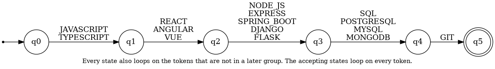
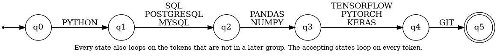
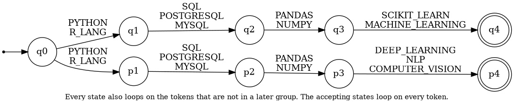
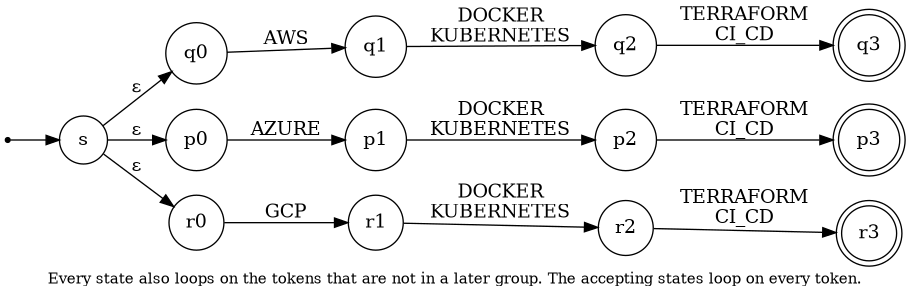

# Formal Definition of the Stage 3 Automata

## 1. Purpose

Stage 3 decides which professional profiles a candidate fits. It receives the tokens from Stage 2 and uses one finite automaton for each of the four profiles: Full Stack Developer, Machine Learning Engineer, Data Scientist and Cloud Engineer. The result for each profile is `ACCEPTED` or `REJECTED`. One candidate can be accepted by more than one profile.

The four profiles go through the same solution. There is one function, `build_automaton`, in `classification/src/automata.py`. It reads a table that describes the pattern of each profile and builds the automaton with pyformlang. No profile has its own code.

## 2. Definition used for every automaton

Every automaton is a tuple M = (Q, Σ, δ, q0, F):

- **Q** is the finite set of states.
- **Σ** is the input alphabet: the 40 tokens of the vocabulary in `docs/tokens.md`.
- **δ** is the transition function (DFA) or relation (NFA and ε-NFA). In an NFA, δ gives a set of states. In an ε-NFA it can also use ε, which moves without reading a token.
- **q0** is the start state.
- **F** is the set of accepting states.

A sequence of tokens is accepted if there is a path from the start state that reads the whole sequence and ends in a state of F.

## 3. How a pattern becomes an automaton

The pattern of a profile is a list of **groups**. A group is a set of tokens that can replace each other: one token of the group is enough. A **route** is an ordered list of groups, for example `JAVASCRIPT|TYPESCRIPT` then `REACT|ANGULAR|VUE`.

The input of the automaton is already sorted by the order of the profile (`normalization/src/sorter.py`), so the groups appear in the same order as in the route. A route with n groups has the states 0, 1, ..., n. State i means that the first i groups are satisfied. The rule for state i is:

1. **Advance.** On any token of group i + 1, go to state i + 1.
2. **Stay.** On any token that is not in groups i + 1, ..., n, stay in state i. This covers tokens that do not matter for the profile and tokens of groups that are already satisfied.
3. **Reject.** On a token of group i + 2 or later there is no transition. In a sorted input that token would only appear before group i + 1 if group i + 1 is missing, so the sequence is rejected.
4. **Accept.** State n is accepting and stays on every token.

Because of rule 3, the automaton needs the sorted input. An unsorted sequence can be rejected even if the candidate has all the skills. That is why `classify` sorts the tokens with the order of each profile before running its automaton.

When a profile has several routes, the automaton is the union of the routes. In an NFA the routes share the start state `q0`, and the loops of `q0` are the loops that the routes have in common. In an ε-NFA a new start state `s` goes to the start of every route with an ε-transition.

## 4. Summary

| Profile | Type | Routes | States |
|---|---|---|---|
| Full Stack Developer | DFA | 1 | 6 |
| Machine Learning Engineer | DFA | 1 | 6 |
| Data Scientist | NFA | 2 | 9 |
| Cloud Engineer | ε-NFA | 3 | 13 |

## 5. The four automata

### 5.1 Full Stack Developer (`full_stack`)

**Pattern.** The candidate must show, in this order, one of `JAVASCRIPT` or `TYPESCRIPT`, one frontend framework, one backend technology, one database and `GIT`. The other tokens (`HTML`, `CSS`, `REST_API`, `DOCKER`, and so on) are allowed but not required. This follows the reference profile of the assignment.

Pattern as groups (one of the tokens of each group is enough):

(`JAVASCRIPT` | `TYPESCRIPT`) → (`REACT` | `ANGULAR` | `VUE`) → (`NODE_JS` | `EXPRESS` | `SPRING_BOOT` | `DJANGO` | `FLASK`) → (`SQL` | `POSTGRESQL` | `MYSQL` | `MONGODB`) → `GIT`

**Type.** It is a **DFA**. For every state and every token there is at most one next state, there are no ε-transitions, and there is only one start state. The pattern is one sequence of groups, so there is never a choice between two paths.

**Formal definition** M = (Q, Σ, δ, q0, F)

- **Q** = {q0, q1, q2, q3, q4, q5} (6 states)
- **Σ** = the 40 tokens of `docs/tokens.md`
- **q0** = q0
- **F** = {q5}
- **δ**: given in the table below and by the rule of section 3.

| State | Meaning | Reads | Goes to | Loops on |
|---|---|---|---|---|
| q0 | nothing is satisfied yet | `JAVASCRIPT`, `TYPESCRIPT` | q1 | all tokens except the 15 tokens of the groups that are not satisfied yet |
| q1 | the first group is satisfied | `REACT`, `ANGULAR`, `VUE` | q2 | all tokens except the 13 tokens of the groups that are not satisfied yet |
| q2 | the first 2 groups are satisfied | `NODE_JS`, `EXPRESS`, `SPRING_BOOT`, `DJANGO`, `FLASK` | q3 | all tokens except the 10 tokens of the groups that are not satisfied yet |
| q3 | the first 3 groups are satisfied | `SQL`, `POSTGRESQL`, `MYSQL`, `MONGODB` | q4 | all tokens except the 5 tokens of the groups that are not satisfied yet |
| q4 | the first 4 groups are satisfied | `GIT` | q5 | all tokens except the 1 tokens of the groups that are not satisfied yet |
| q5 | all groups are satisfied (accepting) | - | - | all 40 tokens |

Transition diagram:



Examples:

| Sequence (already sorted) | Result | Reason |
|---|---|---|
| JAVASCRIPT, REACT, NODE_JS, POSTGRESQL, GIT | ACCEPTED | all five groups are present |
| JAVASCRIPT, REACT, NODE_JS, POSTGRESQL | REJECTED | `GIT` is missing |
| JAVASCRIPT, TYPESCRIPT, REACT, NODE_JS, SPRING_BOOT, REST_API, POSTGRESQL, MONGODB, DOCKER | REJECTED | `GIT` is missing |

### 5.2 Machine Learning Engineer (`ml_engineer`)

**Pattern.** The candidate must show `PYTHON`, one SQL database (`SQL`, `POSTGRESQL` or `MYSQL`), `PANDAS` or `NUMPY`, one deep-learning framework and `GIT`. `SCIKIT_LEARN` and `MACHINE_LEARNING` are allowed but not required. The example of the assignment (`PYTHON`, `PANDAS`, `TENSORFLOW`, `POSTGRESQL`, `GIT`) is accepted.

Pattern as groups (one of the tokens of each group is enough):

`PYTHON` → (`SQL` | `POSTGRESQL` | `MYSQL`) → (`PANDAS` | `NUMPY`) → (`TENSORFLOW` | `PYTORCH` | `KERAS`) → `GIT`

**Type.** It is a **DFA**. The pattern is one sequence of groups. From every state, each token has at most one next state, and there are no ε-transitions.

**Formal definition** M = (Q, Σ, δ, q0, F)

- **Q** = {q0, q1, q2, q3, q4, q5} (6 states)
- **Σ** = the 40 tokens of `docs/tokens.md`
- **q0** = q0
- **F** = {q5}
- **δ**: given in the table below and by the rule of section 3.

| State | Meaning | Reads | Goes to | Loops on |
|---|---|---|---|---|
| q0 | nothing is satisfied yet | `PYTHON` | q1 | all tokens except the 10 tokens of the groups that are not satisfied yet |
| q1 | the first group is satisfied | `SQL`, `POSTGRESQL`, `MYSQL` | q2 | all tokens except the 9 tokens of the groups that are not satisfied yet |
| q2 | the first 2 groups are satisfied | `PANDAS`, `NUMPY` | q3 | all tokens except the 6 tokens of the groups that are not satisfied yet |
| q3 | the first 3 groups are satisfied | `TENSORFLOW`, `PYTORCH`, `KERAS` | q4 | all tokens except the 4 tokens of the groups that are not satisfied yet |
| q4 | the first 4 groups are satisfied | `GIT` | q5 | all tokens except the 1 tokens of the groups that are not satisfied yet |
| q5 | all groups are satisfied (accepting) | - | - | all 40 tokens |

Transition diagram:



Examples:

| Sequence (already sorted) | Result | Reason |
|---|---|---|
| PYTHON, POSTGRESQL, PANDAS, TENSORFLOW, GIT | ACCEPTED | example of the assignment |
| PYTHON, SQL, PANDAS, SCIKIT_LEARN, GIT | REJECTED | no deep-learning framework |
| PYTHON, SQL, PANDAS, TENSORFLOW | REJECTED | `GIT` is missing |

### 5.3 Data Scientist (`data_scientist`)

**Pattern.** The candidate must show a language (`PYTHON` or `R_LANG`), one SQL database, `PANDAS` or `NUMPY`, and one modeling skill. A modeling skill is either classic (`SCIKIT_LEARN`, `MACHINE_LEARNING`) or deep (`DEEP_LEARNING`, `NLP`, `COMPUTER_VISION`). Unlike the Machine Learning Engineer, a deep-learning framework and `GIT` are not required.

Pattern as groups (one of the tokens of each group is enough). The automaton has 2 routes and accepts a sequence that follows at least one of them:

1. (`PYTHON` | `R_LANG`) → (`SQL` | `POSTGRESQL` | `MYSQL`) → (`PANDAS` | `NUMPY`) → (`SCIKIT_LEARN` | `MACHINE_LEARNING`)
2. (`PYTHON` | `R_LANG`) → (`SQL` | `POSTGRESQL` | `MYSQL`) → (`PANDAS` | `NUMPY`) → (`DEEP_LEARNING` | `NLP` | `COMPUTER_VISION`)

**Type.** It is an **NFA**. The pattern has two alternative routes that begin with the same three groups: the classic route (`SCIKIT_LEARN` or `MACHINE_LEARNING`) and the deep-learning route (`DEEP_LEARNING`, `NLP` or `COMPUTER_VISION`). From `q0`, reading `PYTHON` or `R_LANG` leads to two states (`q1` and `p1`), so δ(q0, `PYTHON`) = {q1, p1} has two elements. There are no ε-transitions. A DFA would accept the same words, but the NFA copies the two alternatives of the pattern directly.

**Formal definition** M = (Q, Σ, δ, q0, F)

- **Q** = {q0, q1, q2, q3, q4, p1, p2, p3, p4} (9 states)
- **Σ** = the 40 tokens of `docs/tokens.md`
- **q0** = q0
- **F** = {q4, p4}
- **δ**: given in the table below and by the rule of section 3.

| State | Meaning | Reads | Goes to | Loops on |
|---|---|---|---|---|
| q0 | nothing is satisfied yet | `PYTHON`, `R_LANG` | q1 and p1 | all tokens except the 7 tokens of the groups that are not satisfied yet |
| q1 | the first group is satisfied | `SQL`, `POSTGRESQL`, `MYSQL` | q2 | all tokens except the 7 tokens of the groups that are not satisfied yet |
| q2 | the first 2 groups are satisfied | `PANDAS`, `NUMPY` | q3 | all tokens except the 4 tokens of the groups that are not satisfied yet |
| q3 | the first 3 groups are satisfied | `SCIKIT_LEARN`, `MACHINE_LEARNING` | q4 | all tokens except the 2 tokens of the groups that are not satisfied yet |
| q4 | all groups are satisfied (accepting) | - | - | all 40 tokens |
| p1 | the first group is satisfied | `SQL`, `POSTGRESQL`, `MYSQL` | p2 | all tokens except the 8 tokens of the groups that are not satisfied yet |
| p2 | the first 2 groups are satisfied | `PANDAS`, `NUMPY` | p3 | all tokens except the 5 tokens of the groups that are not satisfied yet |
| p3 | the first 3 groups are satisfied | `DEEP_LEARNING`, `NLP`, `COMPUTER_VISION` | p4 | all tokens except the 3 tokens of the groups that are not satisfied yet |
| p4 | all groups are satisfied (accepting) | - | - | all 40 tokens |

Transition diagram:



Examples:

| Sequence (already sorted) | Result | Reason |
|---|---|---|
| PYTHON, SQL, PANDAS, SCIKIT_LEARN | ACCEPTED | classic route |
| R_LANG, MYSQL, NUMPY, NLP | ACCEPTED | deep-learning route |
| PYTHON, SQL, PANDAS | REJECTED | no modeling skill |

### 5.4 Cloud Engineer (`cloud_engineer`)

**Pattern.** The candidate must show one cloud provider (`AWS`, `AZURE` or `GCP`), one container tool (`DOCKER` or `KUBERNETES`) and one automation tool (`TERRAFORM` or `CI_CD`). `LINUX`, `PYTHON` and `GIT` are allowed but not required.

Pattern as groups (one of the tokens of each group is enough). The automaton has 3 routes and accepts a sequence that follows at least one of them:

1. `AWS` → (`DOCKER` | `KUBERNETES`) → (`TERRAFORM` | `CI_CD`)
2. `AZURE` → (`DOCKER` | `KUBERNETES`) → (`TERRAFORM` | `CI_CD`)
3. `GCP` → (`DOCKER` | `KUBERNETES`) → (`TERRAFORM` | `CI_CD`)

**Type.** It is an **ε-NFA**. The profile accepts one of three cloud providers, and each provider has its own route. The new start state `s` reaches the three routes with ε-transitions (`s` → `q0`, `p0` and `r0` without reading any token). This is the usual way to join alternatives, so it needs ε-transitions.

**Formal definition** M = (Q, Σ, δ, q0, F)

- **Q** = {s, q0, q1, q2, q3, p0, p1, p2, p3, r0, r1, r2, r3} (13 states)
- **Σ** = the 40 tokens of `docs/tokens.md`
- **q0** = s
- **F** = {q3, p3, r3}
- **δ**: given in the table below and by the rule of section 3.

ε-transitions: δ(s, ε) = {q0, p0, r0}.

| State | Meaning | Reads | Goes to | Loops on |
|---|---|---|---|---|
| q0 | nothing is satisfied yet | `AWS` | q1 | all tokens except the 5 tokens of the groups that are not satisfied yet |
| q1 | the first group is satisfied | `DOCKER`, `KUBERNETES` | q2 | all tokens except the 4 tokens of the groups that are not satisfied yet |
| q2 | the first 2 groups are satisfied | `TERRAFORM`, `CI_CD` | q3 | all tokens except the 2 tokens of the groups that are not satisfied yet |
| q3 | all groups are satisfied (accepting) | - | - | all 40 tokens |
| p0 | nothing is satisfied yet | `AZURE` | p1 | all tokens except the 5 tokens of the groups that are not satisfied yet |
| p1 | the first group is satisfied | `DOCKER`, `KUBERNETES` | p2 | all tokens except the 4 tokens of the groups that are not satisfied yet |
| p2 | the first 2 groups are satisfied | `TERRAFORM`, `CI_CD` | p3 | all tokens except the 2 tokens of the groups that are not satisfied yet |
| p3 | all groups are satisfied (accepting) | - | - | all 40 tokens |
| r0 | nothing is satisfied yet | `GCP` | r1 | all tokens except the 5 tokens of the groups that are not satisfied yet |
| r1 | the first group is satisfied | `DOCKER`, `KUBERNETES` | r2 | all tokens except the 4 tokens of the groups that are not satisfied yet |
| r2 | the first 2 groups are satisfied | `TERRAFORM`, `CI_CD` | r3 | all tokens except the 2 tokens of the groups that are not satisfied yet |
| r3 | all groups are satisfied (accepting) | - | - | all 40 tokens |

The start state `s` has no loops and only the three ε-transitions.

Transition diagram:



Examples:

| Sequence (already sorted) | Result | Reason |
|---|---|---|
| AWS, DOCKER, TERRAFORM | ACCEPTED | AWS route |
| LINUX, AZURE, KUBERNETES, CI_CD, GIT | ACCEPTED | Azure route, extra tokens are ignored |
| LINUX, DOCKER, TERRAFORM, GIT | REJECTED | no cloud provider |

## 6. Complete example

From a résumé fragment to the final classification (Stages 1, 2 and 3):

```
Skills: python, pandas, numpy, sklearn, TensorFlow, SQL, Git
-> extraction  : python, pandas, numpy, sklearn, TensorFlow, SQL, Git
-> transducers : PYTHON, PANDAS, NUMPY, SCIKIT_LEARN, TENSORFLOW, SQL, GIT
-> sorting     : sorted again with the order of each profile
-> full_stack     : REJECTED
-> ml_engineer    : ACCEPTED
-> data_scientist : ACCEPTED
-> cloud_engineer : REJECTED
```

The candidate is accepted by two profiles, so the DSL of Stage 4 receives two `classification` lines: Machine Learning Engineer and Data Scientist.

## 7. Decisions and limits

- The accepted patterns are a team decision. The assignment lists qualifications that a profile "may include", so the patterns use the main ones and leave the rest optional.
- `GIT` is required for Full Stack Developer and Machine Learning Engineer because the reference profiles list it. A résumé without Git is rejected for those profiles.
- A token only counts if the candidate wrote it. The automata do not measure years or level.
- The patterns need the sorted input. The order of each profile is in `docs/formalization.md`, section 6, and a test checks that every group follows that order.
- Skills that Stage 2 does not know are not tokens, so they do not help any profile.

## 8. Tests

```
python -m unittest discover -s classification/tests
```

The tests check the examples of the assignment, the type of each automaton (DFA, NFA or ε-NFA), the number of states, that every token of every group is accepted, that removing a whole group makes the sequence be rejected, that extra tokens do not change the result, and 400 random candidates for each profile compared with a direct rule (every group has at least one token). They also check that the groups follow the sorting order and that the four example résumés of Stage 1 are classified as expected.
