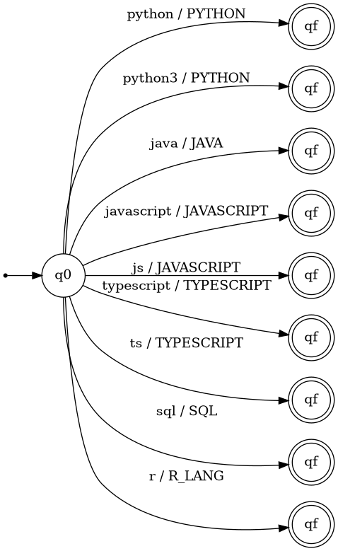
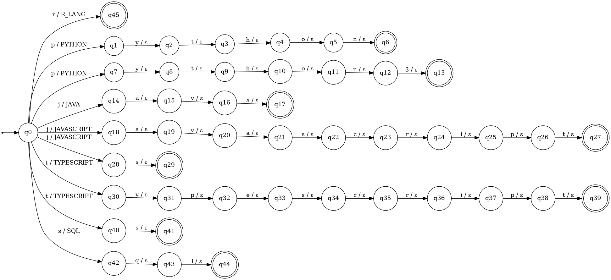
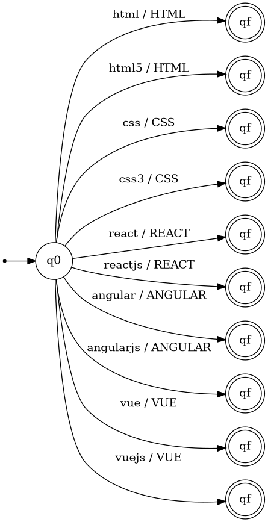
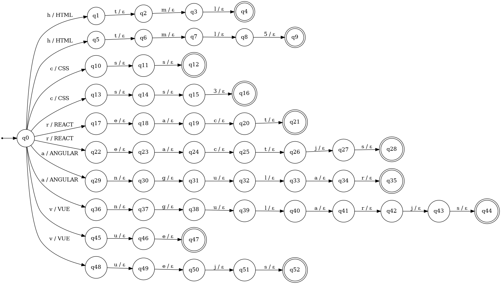
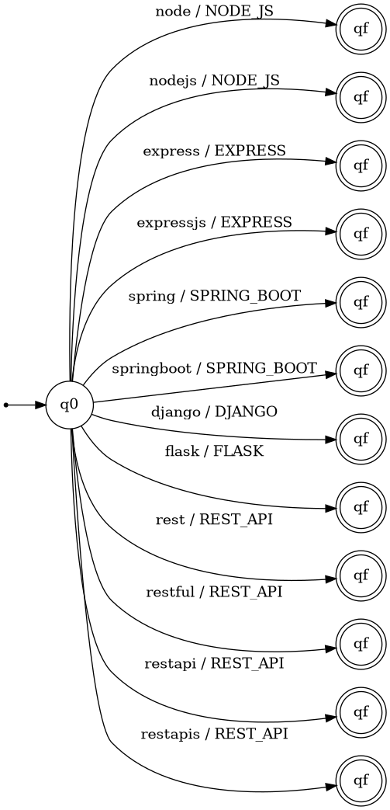
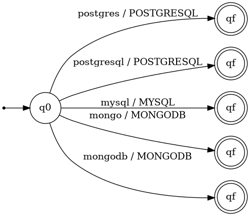
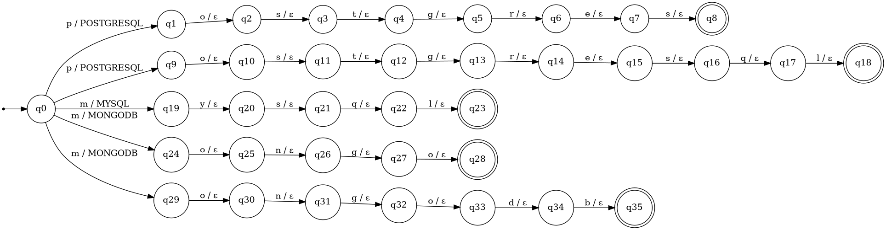
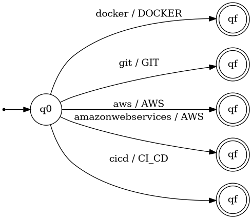
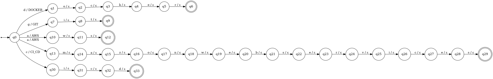
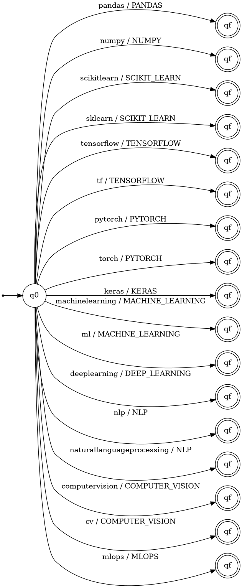

# Formal Definition of the Stage 2 Transducers

## 1. Purpose

Stage 2 turns the different ways a skill can be written into one canonical name (a token). For example, `Node.js`, `NodeJS` and `node` all become `NODE_JS`. The list of tokens is in `docs/tokens.md`. The code is in `normalization/src/transducers.py` and the tests are in `normalization/tests/`.

## 2. Definition used for every transducer

Each transducer is a finite-state transducer M = (Q, Σ, Γ, δ, ω, q0, F), where:

- **Q** is a finite set of states.
- **Σ** is the input alphabet: the lowercase letters and digits that appear in the accepted spellings.
- **Γ** is the output alphabet: the tokens of the category.
- **δ ⊆ Q × Σ × Q** is the transition relation.
- **ω: δ → Γ\*** is the output relation. It tells which output is written when a transition is used. It is `ε` (nothing) on every transition except the first one of each spelling.
- **q0** is the initial state.
- **F** is the set of accepting states: the last state of each spelling.

The transducers are not deterministic: from `q0` there is one transition for each spelling, so two spellings that start with the same letter have two transitions with that letter. Only the path that follows the whole input and ends in an accepting state gives an output.

## 3. How the input is prepared

Before a skill goes into a transducer it is simplified: all letters become lowercase and every character that is not a letter or a digit is removed.

| Skill in the résumé | Simplified input |
|---|---|
| `Node.js` | `nodejs` |
| `Scikit-learn` | `scikitlearn` |
| `Tensor Flow` | `tensorflow` |
| `CI/CD` | `cicd` |
| `REST APIs` | `restapis` |

## 4. How each transducer is built

Each accepted spelling is its own chain of states that starts at `q0`. The chain has one transition for each letter. The first transition writes the token and the others write nothing (`ε`). The state where the chain ends is an accepting state. The token only comes out if the whole input follows the chain until its last state.

Example, with the transducer `backend` and the skill `Node.js`:

```
(q0, n) -> (q5, NODE_JS)
(q5, o) -> (q6, ε)
(q6, d) -> (q7, ε)
(q7, e) -> (q8, ε)
(q8, j) -> (q9, ε)
(q9, s) -> (q10, ε)
```
The output is `NODE_JS`.

Because a spelling that is not in the list has no chain that ends in an accepting state, the transducer gives no output for it. The code reports those skills as unknown. A shorter or longer text is not accepted either: `nod` or `nodejss` give no output.

## 5. The six transducers

The tokens are split by category, so each transducer has a small and clear purpose. The code tries the six transducers in order until one of them gives an output.

| Transducer | Tokens (Γ) | Spellings | Number of states |
|---|---|---|---|
| Programming languages (`languages`) | 6 | 9 | 46 |
| Frontend (`frontend`) | 5 | 10 | 53 |
| Backend (`backend`) | 6 | 12 | 80 |
| Databases (`databases`) | 3 | 5 | 36 |
| DevOps and tools (`devops`) | 4 | 5 | 34 |
| Data and machine learning (`data_ml`) | 11 | 17 | 137 |

### 5.1 Programming languages (`languages`)

- **Q** = {q0, q1, ..., q45} (46 states)
- **Σ** = {3, a, c, e, h, i, j, l, n, o, p, q, r, s, t, v, y}
- **Γ** = {JAVA, JAVASCRIPT, PYTHON, R_LANG, SQL, TYPESCRIPT}
- **q0** = q0
- **F** = 9 accepting states, one for each spelling
- **δ and ω**: 45 transitions, listed in the appendix (section 8).

Accepted spellings:

| Spelling | Output |
|---|---|
| `python` | `PYTHON` |
| `python3` | `PYTHON` |
| `java` | `JAVA` |
| `javascript` | `JAVASCRIPT` |
| `js` | `JAVASCRIPT` |
| `typescript` | `TYPESCRIPT` |
| `ts` | `TYPESCRIPT` |
| `sql` | `SQL` |
| `r` | `R_LANG` |

Diagram, compact version (each chain of states is drawn as one arrow with the whole spelling):



Diagram, complete version (one arrow per letter, written as `letter / output`):



### 5.2 Frontend (`frontend`)

- **Q** = {q0, q1, ..., q52} (53 states)
- **Σ** = {3, 5, a, c, e, g, h, j, l, m, n, r, s, t, u, v}
- **Γ** = {ANGULAR, CSS, HTML, REACT, VUE}
- **q0** = q0
- **F** = 10 accepting states, one for each spelling
- **δ and ω**: 52 transitions, listed in the appendix (section 8).

Accepted spellings:

| Spelling | Output |
|---|---|
| `html` | `HTML` |
| `html5` | `HTML` |
| `css` | `CSS` |
| `css3` | `CSS` |
| `react` | `REACT` |
| `reactjs` | `REACT` |
| `angular` | `ANGULAR` |
| `angularjs` | `ANGULAR` |
| `vue` | `VUE` |
| `vuejs` | `VUE` |

Diagram, compact version (each chain of states is drawn as one arrow with the whole spelling):



Diagram, complete version (one arrow per letter, written as `letter / output`):



### 5.3 Backend (`backend`)

- **Q** = {q0, q1, ..., q79} (80 states)
- **Σ** = {a, b, d, e, f, g, i, j, k, l, n, o, p, r, s, t, u, x}
- **Γ** = {DJANGO, EXPRESS, FLASK, NODE_JS, REST_API, SPRING_BOOT}
- **q0** = q0
- **F** = 12 accepting states, one for each spelling
- **δ and ω**: 79 transitions, listed in the appendix (section 8).

Accepted spellings:

| Spelling | Output |
|---|---|
| `node` | `NODE_JS` |
| `nodejs` | `NODE_JS` |
| `express` | `EXPRESS` |
| `expressjs` | `EXPRESS` |
| `spring` | `SPRING_BOOT` |
| `springboot` | `SPRING_BOOT` |
| `django` | `DJANGO` |
| `flask` | `FLASK` |
| `rest` | `REST_API` |
| `restful` | `REST_API` |
| `restapi` | `REST_API` |
| `restapis` | `REST_API` |

Diagram, compact version (each chain of states is drawn as one arrow with the whole spelling):



The complete diagram has 80 states and is too wide to read on a page. It is saved in `docs/diagrams/transducers/backend_full.png`.

### 5.4 Databases (`databases`)

- **Q** = {q0, q1, ..., q35} (36 states)
- **Σ** = {b, d, e, g, l, m, n, o, p, q, r, s, t, y}
- **Γ** = {MONGODB, MYSQL, POSTGRESQL}
- **q0** = q0
- **F** = 5 accepting states, one for each spelling
- **δ and ω**: 35 transitions, listed in the appendix (section 8).

Accepted spellings:

| Spelling | Output |
|---|---|
| `postgres` | `POSTGRESQL` |
| `postgresql` | `POSTGRESQL` |
| `mysql` | `MYSQL` |
| `mongo` | `MONGODB` |
| `mongodb` | `MONGODB` |

Diagram, compact version (each chain of states is drawn as one arrow with the whole spelling):



Diagram, complete version (one arrow per letter, written as `letter / output`):



### 5.5 DevOps and tools (`devops`)

- **Q** = {q0, q1, ..., q33} (34 states)
- **Σ** = {a, b, c, d, e, g, i, k, m, n, o, r, s, t, v, w, z}
- **Γ** = {AWS, CI_CD, DOCKER, GIT}
- **q0** = q0
- **F** = 5 accepting states, one for each spelling
- **δ and ω**: 33 transitions, listed in the appendix (section 8).

Accepted spellings:

| Spelling | Output |
|---|---|
| `docker` | `DOCKER` |
| `git` | `GIT` |
| `aws` | `AWS` |
| `amazonwebservices` | `AWS` |
| `cicd` | `CI_CD` |

Diagram, compact version (each chain of states is drawn as one arrow with the whole spelling):



Diagram, complete version (one arrow per letter, written as `letter / output`):



### 5.6 Data and machine learning (`data_ml`)

- **Q** = {q0, q1, ..., q136} (137 states)
- **Σ** = {a, c, d, e, f, g, h, i, k, l, m, n, o, p, r, s, t, u, v, w, y}
- **Γ** = {COMPUTER_VISION, DEEP_LEARNING, KERAS, MACHINE_LEARNING, MLOPS, NLP, NUMPY, PANDAS, PYTORCH, SCIKIT_LEARN, TENSORFLOW}
- **q0** = q0
- **F** = 17 accepting states, one for each spelling
- **δ and ω**: 136 transitions, listed in the appendix (section 8).

Accepted spellings:

| Spelling | Output |
|---|---|
| `pandas` | `PANDAS` |
| `numpy` | `NUMPY` |
| `scikitlearn` | `SCIKIT_LEARN` |
| `sklearn` | `SCIKIT_LEARN` |
| `tensorflow` | `TENSORFLOW` |
| `tf` | `TENSORFLOW` |
| `pytorch` | `PYTORCH` |
| `torch` | `PYTORCH` |
| `keras` | `KERAS` |
| `machinelearning` | `MACHINE_LEARNING` |
| `ml` | `MACHINE_LEARNING` |
| `deeplearning` | `DEEP_LEARNING` |
| `nlp` | `NLP` |
| `naturallanguageprocessing` | `NLP` |
| `computervision` | `COMPUTER_VISION` |
| `cv` | `COMPUTER_VISION` |
| `mlops` | `MLOPS` |

Diagram, compact version (each chain of states is drawn as one arrow with the whole spelling):



The complete diagram has 137 states and is too wide to read on a page. It is saved in `docs/diagrams/transducers/data_ml_full.png`.

In the compact diagrams every spelling goes to its own copy of `qf`. This is only to keep the drawing clean: each copy stands for the accepting state at the end of that chain.

## 6. Sorting the normalized tokens

After normalization the tokens are sorted with a fixed order defined by the profile (`normalization/src/sorter.py`). This way the result does not depend on the order in which the candidate wrote the skills. Tokens that are not in the order of the profile go at the end, in the order they came.

| Profile | Order |
|---|---|
| `full_stack` | JAVASCRIPT, TYPESCRIPT, JAVA, PYTHON, HTML, CSS, REACT, ANGULAR, VUE, NODE_JS, EXPRESS, SPRING_BOOT, DJANGO, FLASK, REST_API, SQL, POSTGRESQL, MYSQL, MONGODB, DOCKER, AWS, CI_CD, GIT |
| `ml_engineer` | PYTHON, R_LANG, SQL, PANDAS, NUMPY, SCIKIT_LEARN, TENSORFLOW, PYTORCH, KERAS, MACHINE_LEARNING, DEEP_LEARNING, NLP, COMPUTER_VISION, MLOPS, DOCKER, AWS, GIT |
| Team profile (software) | Pending |
| Team profile (AI / data) | Pending |

Example for the Full Stack profile:

```
Git, NodeJS, JS, Postgres, React.js
-> JAVASCRIPT, REACT, NODE_JS, POSTGRESQL, GIT
```

## 7. Tests

```
python -m unittest discover -s normalization/tests
```

The tests check every spelling of every token, the examples of the assignment, the skills found in the four example résumés, that no spelling belongs to two categories, and the order of each profile.

## 8. Appendix: transitions

Each line is `(state, symbol) -> (next state, output)`, which means that from `state`, reading `symbol`, the transducer goes to `next state` and writes `output`.

### Programming languages (`languages`)

```
(q0, j) -> (q14, JAVA)
(q0, j) -> (q18, JAVASCRIPT)
(q0, j) -> (q28, JAVASCRIPT)
(q0, p) -> (q1, PYTHON)
(q0, p) -> (q7, PYTHON)
(q0, r) -> (q45, R_LANG)
(q0, s) -> (q42, SQL)
(q0, t) -> (q30, TYPESCRIPT)
(q0, t) -> (q40, TYPESCRIPT)
(q1, y) -> (q2, ε)
(q2, t) -> (q3, ε)
(q3, h) -> (q4, ε)
(q4, o) -> (q5, ε)
(q5, n) -> (q6, ε)
(q7, y) -> (q8, ε)
(q8, t) -> (q9, ε)
(q9, h) -> (q10, ε)
(q10, o) -> (q11, ε)
(q11, n) -> (q12, ε)
(q12, 3) -> (q13, ε)
(q14, a) -> (q15, ε)
(q15, v) -> (q16, ε)
(q16, a) -> (q17, ε)
(q18, a) -> (q19, ε)
(q19, v) -> (q20, ε)
(q20, a) -> (q21, ε)
(q21, s) -> (q22, ε)
(q22, c) -> (q23, ε)
(q23, r) -> (q24, ε)
(q24, i) -> (q25, ε)
(q25, p) -> (q26, ε)
(q26, t) -> (q27, ε)
(q28, s) -> (q29, ε)
(q30, y) -> (q31, ε)
(q31, p) -> (q32, ε)
(q32, e) -> (q33, ε)
(q33, s) -> (q34, ε)
(q34, c) -> (q35, ε)
(q35, r) -> (q36, ε)
(q36, i) -> (q37, ε)
(q37, p) -> (q38, ε)
(q38, t) -> (q39, ε)
(q40, s) -> (q41, ε)
(q42, q) -> (q43, ε)
(q43, l) -> (q44, ε)
```

### Frontend (`frontend`)

```
(q0, a) -> (q29, ANGULAR)
(q0, a) -> (q36, ANGULAR)
(q0, c) -> (q10, CSS)
(q0, c) -> (q13, CSS)
(q0, h) -> (q1, HTML)
(q0, h) -> (q5, HTML)
(q0, r) -> (q17, REACT)
(q0, r) -> (q22, REACT)
(q0, v) -> (q45, VUE)
(q0, v) -> (q48, VUE)
(q1, t) -> (q2, ε)
(q2, m) -> (q3, ε)
(q3, l) -> (q4, ε)
(q5, t) -> (q6, ε)
(q6, m) -> (q7, ε)
(q7, l) -> (q8, ε)
(q8, 5) -> (q9, ε)
(q10, s) -> (q11, ε)
(q11, s) -> (q12, ε)
(q13, s) -> (q14, ε)
(q14, s) -> (q15, ε)
(q15, 3) -> (q16, ε)
(q17, e) -> (q18, ε)
(q18, a) -> (q19, ε)
(q19, c) -> (q20, ε)
(q20, t) -> (q21, ε)
(q22, e) -> (q23, ε)
(q23, a) -> (q24, ε)
(q24, c) -> (q25, ε)
(q25, t) -> (q26, ε)
(q26, j) -> (q27, ε)
(q27, s) -> (q28, ε)
(q29, n) -> (q30, ε)
(q30, g) -> (q31, ε)
(q31, u) -> (q32, ε)
(q32, l) -> (q33, ε)
(q33, a) -> (q34, ε)
(q34, r) -> (q35, ε)
(q36, n) -> (q37, ε)
(q37, g) -> (q38, ε)
(q38, u) -> (q39, ε)
(q39, l) -> (q40, ε)
(q40, a) -> (q41, ε)
(q41, r) -> (q42, ε)
(q42, j) -> (q43, ε)
(q43, s) -> (q44, ε)
(q45, u) -> (q46, ε)
(q46, e) -> (q47, ε)
(q48, u) -> (q49, ε)
(q49, e) -> (q50, ε)
(q50, j) -> (q51, ε)
(q51, s) -> (q52, ε)
```

### Backend (`backend`)

```
(q0, d) -> (q43, DJANGO)
(q0, e) -> (q11, EXPRESS)
(q0, e) -> (q18, EXPRESS)
(q0, f) -> (q49, FLASK)
(q0, n) -> (q1, NODE_JS)
(q0, n) -> (q5, NODE_JS)
(q0, r) -> (q54, REST_API)
(q0, r) -> (q58, REST_API)
(q0, r) -> (q65, REST_API)
(q0, r) -> (q72, REST_API)
(q0, s) -> (q27, SPRING_BOOT)
(q0, s) -> (q33, SPRING_BOOT)
(q1, o) -> (q2, ε)
(q2, d) -> (q3, ε)
(q3, e) -> (q4, ε)
(q5, o) -> (q6, ε)
(q6, d) -> (q7, ε)
(q7, e) -> (q8, ε)
(q8, j) -> (q9, ε)
(q9, s) -> (q10, ε)
(q11, x) -> (q12, ε)
(q12, p) -> (q13, ε)
(q13, r) -> (q14, ε)
(q14, e) -> (q15, ε)
(q15, s) -> (q16, ε)
(q16, s) -> (q17, ε)
(q18, x) -> (q19, ε)
(q19, p) -> (q20, ε)
(q20, r) -> (q21, ε)
(q21, e) -> (q22, ε)
(q22, s) -> (q23, ε)
(q23, s) -> (q24, ε)
(q24, j) -> (q25, ε)
(q25, s) -> (q26, ε)
(q27, p) -> (q28, ε)
(q28, r) -> (q29, ε)
(q29, i) -> (q30, ε)
(q30, n) -> (q31, ε)
(q31, g) -> (q32, ε)
(q33, p) -> (q34, ε)
(q34, r) -> (q35, ε)
(q35, i) -> (q36, ε)
(q36, n) -> (q37, ε)
(q37, g) -> (q38, ε)
(q38, b) -> (q39, ε)
(q39, o) -> (q40, ε)
(q40, o) -> (q41, ε)
(q41, t) -> (q42, ε)
(q43, j) -> (q44, ε)
(q44, a) -> (q45, ε)
(q45, n) -> (q46, ε)
(q46, g) -> (q47, ε)
(q47, o) -> (q48, ε)
(q49, l) -> (q50, ε)
(q50, a) -> (q51, ε)
(q51, s) -> (q52, ε)
(q52, k) -> (q53, ε)
(q54, e) -> (q55, ε)
(q55, s) -> (q56, ε)
(q56, t) -> (q57, ε)
(q58, e) -> (q59, ε)
(q59, s) -> (q60, ε)
(q60, t) -> (q61, ε)
(q61, f) -> (q62, ε)
(q62, u) -> (q63, ε)
(q63, l) -> (q64, ε)
(q65, e) -> (q66, ε)
(q66, s) -> (q67, ε)
(q67, t) -> (q68, ε)
(q68, a) -> (q69, ε)
(q69, p) -> (q70, ε)
(q70, i) -> (q71, ε)
(q72, e) -> (q73, ε)
(q73, s) -> (q74, ε)
(q74, t) -> (q75, ε)
(q75, a) -> (q76, ε)
(q76, p) -> (q77, ε)
(q77, i) -> (q78, ε)
(q78, s) -> (q79, ε)
```

### Databases (`databases`)

```
(q0, m) -> (q19, MYSQL)
(q0, m) -> (q24, MONGODB)
(q0, m) -> (q29, MONGODB)
(q0, p) -> (q1, POSTGRESQL)
(q0, p) -> (q9, POSTGRESQL)
(q1, o) -> (q2, ε)
(q2, s) -> (q3, ε)
(q3, t) -> (q4, ε)
(q4, g) -> (q5, ε)
(q5, r) -> (q6, ε)
(q6, e) -> (q7, ε)
(q7, s) -> (q8, ε)
(q9, o) -> (q10, ε)
(q10, s) -> (q11, ε)
(q11, t) -> (q12, ε)
(q12, g) -> (q13, ε)
(q13, r) -> (q14, ε)
(q14, e) -> (q15, ε)
(q15, s) -> (q16, ε)
(q16, q) -> (q17, ε)
(q17, l) -> (q18, ε)
(q19, y) -> (q20, ε)
(q20, s) -> (q21, ε)
(q21, q) -> (q22, ε)
(q22, l) -> (q23, ε)
(q24, o) -> (q25, ε)
(q25, n) -> (q26, ε)
(q26, g) -> (q27, ε)
(q27, o) -> (q28, ε)
(q29, o) -> (q30, ε)
(q30, n) -> (q31, ε)
(q31, g) -> (q32, ε)
(q32, o) -> (q33, ε)
(q33, d) -> (q34, ε)
(q34, b) -> (q35, ε)
```

### DevOps and tools (`devops`)

```
(q0, a) -> (q10, AWS)
(q0, a) -> (q13, AWS)
(q0, c) -> (q30, CI_CD)
(q0, d) -> (q1, DOCKER)
(q0, g) -> (q7, GIT)
(q1, o) -> (q2, ε)
(q2, c) -> (q3, ε)
(q3, k) -> (q4, ε)
(q4, e) -> (q5, ε)
(q5, r) -> (q6, ε)
(q7, i) -> (q8, ε)
(q8, t) -> (q9, ε)
(q10, w) -> (q11, ε)
(q11, s) -> (q12, ε)
(q13, m) -> (q14, ε)
(q14, a) -> (q15, ε)
(q15, z) -> (q16, ε)
(q16, o) -> (q17, ε)
(q17, n) -> (q18, ε)
(q18, w) -> (q19, ε)
(q19, e) -> (q20, ε)
(q20, b) -> (q21, ε)
(q21, s) -> (q22, ε)
(q22, e) -> (q23, ε)
(q23, r) -> (q24, ε)
(q24, v) -> (q25, ε)
(q25, i) -> (q26, ε)
(q26, c) -> (q27, ε)
(q27, e) -> (q28, ε)
(q28, s) -> (q29, ε)
(q30, i) -> (q31, ε)
(q31, c) -> (q32, ε)
(q32, d) -> (q33, ε)
```

### Data and machine learning (`data_ml`)

```
(q0, c) -> (q116, COMPUTER_VISION)
(q0, c) -> (q130, COMPUTER_VISION)
(q0, d) -> (q76, DEEP_LEARNING)
(q0, k) -> (q54, KERAS)
(q0, m) -> (q59, MACHINE_LEARNING)
(q0, m) -> (q74, MACHINE_LEARNING)
(q0, m) -> (q132, MLOPS)
(q0, n) -> (q7, NUMPY)
(q0, n) -> (q88, NLP)
(q0, n) -> (q91, NLP)
(q0, p) -> (q1, PANDAS)
(q0, p) -> (q42, PYTORCH)
(q0, s) -> (q12, SCIKIT_LEARN)
(q0, s) -> (q23, SCIKIT_LEARN)
(q0, t) -> (q30, TENSORFLOW)
(q0, t) -> (q40, TENSORFLOW)
(q0, t) -> (q49, PYTORCH)
(q1, a) -> (q2, ε)
(q2, n) -> (q3, ε)
(q3, d) -> (q4, ε)
(q4, a) -> (q5, ε)
(q5, s) -> (q6, ε)
(q7, u) -> (q8, ε)
(q8, m) -> (q9, ε)
(q9, p) -> (q10, ε)
(q10, y) -> (q11, ε)
(q12, c) -> (q13, ε)
(q13, i) -> (q14, ε)
(q14, k) -> (q15, ε)
(q15, i) -> (q16, ε)
(q16, t) -> (q17, ε)
(q17, l) -> (q18, ε)
(q18, e) -> (q19, ε)
(q19, a) -> (q20, ε)
(q20, r) -> (q21, ε)
(q21, n) -> (q22, ε)
(q23, k) -> (q24, ε)
(q24, l) -> (q25, ε)
(q25, e) -> (q26, ε)
(q26, a) -> (q27, ε)
(q27, r) -> (q28, ε)
(q28, n) -> (q29, ε)
(q30, e) -> (q31, ε)
(q31, n) -> (q32, ε)
(q32, s) -> (q33, ε)
(q33, o) -> (q34, ε)
(q34, r) -> (q35, ε)
(q35, f) -> (q36, ε)
(q36, l) -> (q37, ε)
(q37, o) -> (q38, ε)
(q38, w) -> (q39, ε)
(q40, f) -> (q41, ε)
(q42, y) -> (q43, ε)
(q43, t) -> (q44, ε)
(q44, o) -> (q45, ε)
(q45, r) -> (q46, ε)
(q46, c) -> (q47, ε)
(q47, h) -> (q48, ε)
(q49, o) -> (q50, ε)
(q50, r) -> (q51, ε)
(q51, c) -> (q52, ε)
(q52, h) -> (q53, ε)
(q54, e) -> (q55, ε)
(q55, r) -> (q56, ε)
(q56, a) -> (q57, ε)
(q57, s) -> (q58, ε)
(q59, a) -> (q60, ε)
(q60, c) -> (q61, ε)
(q61, h) -> (q62, ε)
(q62, i) -> (q63, ε)
(q63, n) -> (q64, ε)
(q64, e) -> (q65, ε)
(q65, l) -> (q66, ε)
(q66, e) -> (q67, ε)
(q67, a) -> (q68, ε)
(q68, r) -> (q69, ε)
(q69, n) -> (q70, ε)
(q70, i) -> (q71, ε)
(q71, n) -> (q72, ε)
(q72, g) -> (q73, ε)
(q74, l) -> (q75, ε)
(q76, e) -> (q77, ε)
(q77, e) -> (q78, ε)
(q78, p) -> (q79, ε)
(q79, l) -> (q80, ε)
(q80, e) -> (q81, ε)
(q81, a) -> (q82, ε)
(q82, r) -> (q83, ε)
(q83, n) -> (q84, ε)
(q84, i) -> (q85, ε)
(q85, n) -> (q86, ε)
(q86, g) -> (q87, ε)
(q88, l) -> (q89, ε)
(q89, p) -> (q90, ε)
(q91, a) -> (q92, ε)
(q92, t) -> (q93, ε)
(q93, u) -> (q94, ε)
(q94, r) -> (q95, ε)
(q95, a) -> (q96, ε)
(q96, l) -> (q97, ε)
(q97, l) -> (q98, ε)
(q98, a) -> (q99, ε)
(q99, n) -> (q100, ε)
(q100, g) -> (q101, ε)
(q101, u) -> (q102, ε)
(q102, a) -> (q103, ε)
(q103, g) -> (q104, ε)
(q104, e) -> (q105, ε)
(q105, p) -> (q106, ε)
(q106, r) -> (q107, ε)
(q107, o) -> (q108, ε)
(q108, c) -> (q109, ε)
(q109, e) -> (q110, ε)
(q110, s) -> (q111, ε)
(q111, s) -> (q112, ε)
(q112, i) -> (q113, ε)
(q113, n) -> (q114, ε)
(q114, g) -> (q115, ε)
(q116, o) -> (q117, ε)
(q117, m) -> (q118, ε)
(q118, p) -> (q119, ε)
(q119, u) -> (q120, ε)
(q120, t) -> (q121, ε)
(q121, e) -> (q122, ε)
(q122, r) -> (q123, ε)
(q123, v) -> (q124, ε)
(q124, i) -> (q125, ε)
(q125, s) -> (q126, ε)
(q126, i) -> (q127, ε)
(q127, o) -> (q128, ε)
(q128, n) -> (q129, ε)
(q130, v) -> (q131, ε)
(q132, l) -> (q133, ε)
(q133, o) -> (q134, ε)
(q134, p) -> (q135, ε)
(q135, s) -> (q136, ε)
```
