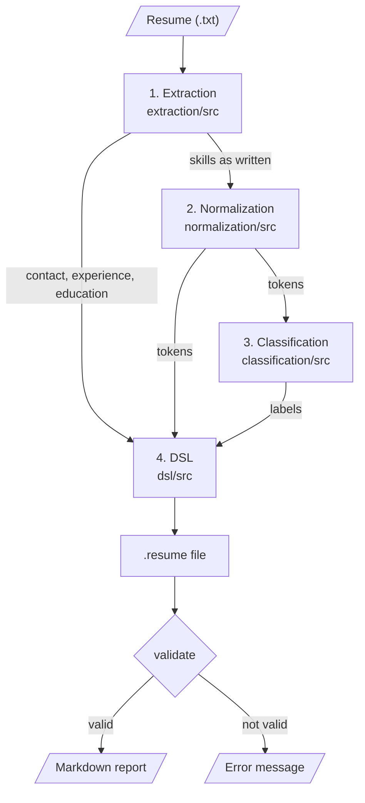

# Module design

This document shows how the four modules connect and what each public function receives and returns.

## 1. Flow

`pipeline.py` and `app.py` call the four modules in this order.

## 2. Stage 1: Extraction (`extraction/src`)

| File | Function | Input | Output |
|---|---|---|---|
| `extractor.py` | `extract(text)` | Résumé text (`str`) | `dict` with `contact`, `experience`, `education` and `skills` |
| `extractor.py` | `extract_file(path, save=True)` | Path of a `.txt` file | Same `dict`; saved as JSON in `extraction/output/` if `save` is true |
| `extractor.py` | `find_all(patterns, text, flags=0)` | List of regex patterns, text | List of matches (`str`) |
| `extractor.py` | `clean(items)` | List of matches | List without duplicates or matches contained in a longer one |
| `skills.py` | `extract_skills(text)` | Résumé text | List of skills as written (`str`) |
| `skills.py` | `clean_text(text)` | Résumé text | Text without emails, links and job titles |

## 3. Stage 2: Normalization (`normalization/src`)

| File | Function | Input | Output |
|---|---|---|---|
| `transducers.py` | `normalize(skills)` | List of skills as written | `dict` with `tokens` (no repeats) and `unknown` |
| `transducers.py` | `normalize_skill(skill, transducers)` | One skill, dict of transducers | One token (`str`) or `None` |
| `transducers.py` | `build_all()` | Nothing | Dict with one pyformlang `FST` per category |
| `transducers.py` | `build_transducer(pairs)` | List of (spelling, token) pairs | One `FST` |
| `transducers.py` | `simplify(text)` | Skill as written | Lowercase text with only letters and digits |
| `sorter.py` | `sort_tokens(tokens, profile)` | List of tokens, profile key | Tokens in the canonical order of that profile |

## 4. Stage 3: Classification (`classification/src`)

| File | Function | Input | Output |
|---|---|---|---|
| `automata.py` | `classify(tokens)` | List of tokens | Dict: profile key -> `"ACCEPTED"` or `"REJECTED"` |
| `automata.py` | `accepted_labels(tokens)` | List of tokens | List of labels of the accepted profiles |
| `automata.py` | `accepts(automaton, tokens)` | Automaton, sorted tokens | `bool` |
| `automata.py` | `build_automaton(profile)` | Profile key | DFA, NFA or ε-NFA (pyformlang) |
| `automata.py` | `build_all()` | Nothing | Dict with one automaton per profile |
| `automata.py` | `PROFILES` | – | Dict with label, type and routes of each profile |

## 5. Stage 4: DSL (`dsl/src`)

| File | Function | Input | Output |
|---|---|---|---|
| `resume_builder.py` | `build_resume(name, location, extracted, tokens, labels)` | Header, Stage 1 result, tokens, labels | Text of a `.resume` file (`str`) |
| `resume_builder.py` | `build_from_text(text, labels)` | Résumé text, labels | Text of a `.resume` file (`str`) |
| `validator.py` | `validate(resume_path)` | Path of a `.resume` file | `(True, model)` or `(False, error message)` |
| `markdown_generator.py` | `generate_markdown(model)` | textX model | Markdown report (`str`) |
| `parser.py` | `Resume.interpret(model)` | textX model | Prints the candidate data |

## 6. Pipeline (`pipeline.py`)

| Function | Input | Output |
|---|---|---|
| `run(text, stem)` | Résumé text, file name without extension | `dict` with `extracted`, `tokens`, `unknown`, `results`, `labels`, `resume_path`, `valid`, `error`, `markdown_path` |
| `read_header(text)` | Résumé text | `(name, location)`; both default to `"Not specified"` |
| `show(path, outcome)` | File path, result of `run` | Prints the result of each stage |
| `main()` | File paths from the command line | Runs `run` on each file |

`app.py` uses the same functions of the four modules and shows each stage in its own tab.
